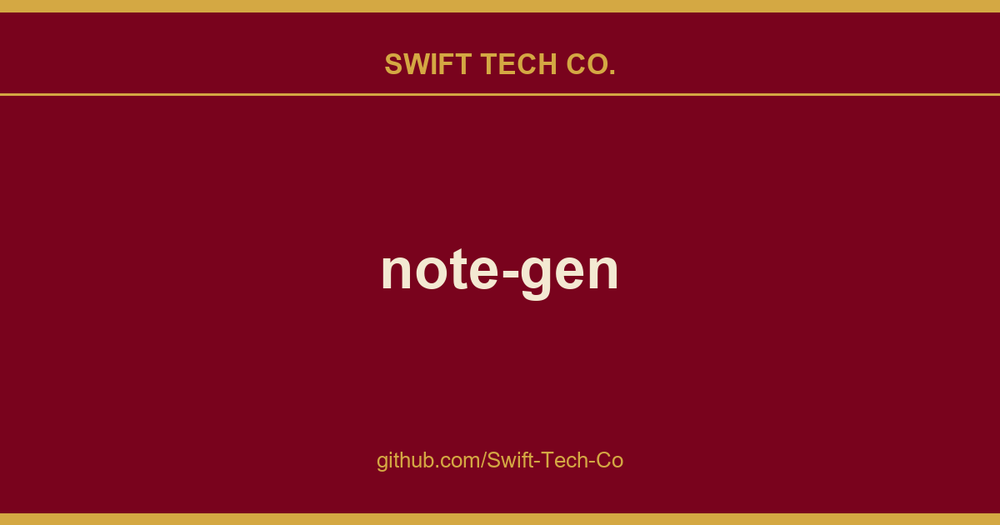

# note-gen

## What This Is

This is part of the Swift Tech Co. working stack for product and engineering. It gathers the note-gen notes, examples and fixes that keep delivery fast, and doubles as the reference map we hand to whoever picks up this thread next.

## Images

## Capture without interrupting your thoughts

An idea may begin as a sentence, a voice recording, a screenshot, or a link you do not have time to read yet. You should not have to choose a title, folder, and structure before saving it.

NoteGen separates capturing from organizing.

Save information as it appears. Later, select the records that belong together and organize them into a structured Markdown note. You can then review the result, add your own thinking, and continue writing.

The goal is not to let AI write everything for you. It is to make sure useful fragments do not disappear before you have time to turn them into something complete.

## How it works

1. **Capture what happened**

   Save a thought, voice recording, screenshot, image, link, file, or todo while it is still fresh.

2. **Choose the material**

   Filter records by tag, time, or type, then select the items that belong together.

3. **Organize the records**

   Choose a template or describe what you want to write. NoteGen can organize the selected material into a summary, report, article, or another Markdown structure.

4. **Keep writing**

   Review the draft in the editor, change the structure, add details, and continue writing in your own words.

## What this looks like in practice

- Record parts of a meeting, add two screenshots, and organize them into meeting notes afterward.
- Save links and reading fragments during the week, then organize them into a research note.
- Filter recent records by tag and prepare a weekly report without searching through several apps.
- Collect images and documents for a topic, then ask questions using those materials as context.

## Built around Markdown files

Your written notes remain ordinary Markdown files in the workspace you choose.

You can edit them with NoteGen, open them with another Markdown editor, keep them in Git, or move them without exporting from a proprietary format. NoteGen adds recording, AI, search, and organization around those files instead of replacing them.

The editor supports:

- Tables, task lists, code blocks, math, diagrams, and document outlines
- Markdown source mode and visual editing
- Search and replace
- Images, attachments, links, and file references
- Export and printing tools
- File history and workspace management

## AI when it is useful

NoteGen connects to the AI providers and models you configure. You can use different models for chat, writing, embeddings, image recognition, OCR, and audio.

AI can help you:

- Organize selected records into a structured note
- Continue, shorten, expand, rewrite, or translate existing text
- Ask questions about notes, records, images, and knowledge base content
- Search local material before answering
- Generate diagrams and charts from your notes
- Work through longer tasks with Agent mode

AI is part of the workflow, but the result remains editable. You decide what to keep.

## Search and reuse your own material

A note should remain useful after you finish writing it.

NoteGen can build a searchable knowledge base from your files and combine semantic retrieval with local text search. You can use a note, a group of records, or the knowledge base as context in a conversation instead of copying everything into a new prompt.

For advanced workflows, NoteGen also supports:

- Vector indexing and hybrid retrieval
- Configurable embedding and reranking models
- Long-term memories and reusable prompts
- MCP servers
- Installable Skills
- Agent tools for working with notes and files

## More than a document editor

NoteGen includes a canvas workspace for material that is easier to understand visually.

You can create and edit:

- Flowcharts
- Mind maps
- Timelines
- Freehand drawings
- Data charts
- Diagrams generated from note content

Canvas elements remain editable after they are created, including content suggested by AI.

## Sync on your terms

Notes are stored locally first. When you need them on another device, you can sync through services you already use.

Supported options include:

- GitHub
- GitLab
- Gitee
- Gitea
- S3-compatible storage
- WebDAV

You can also keep local backups without enabling cloud sync.

## Download

| Platform | Status | Download |
| --- | --- | --- |
| Windows | Beta | Download for Windows |
| macOS | Beta | Download for Apple Silicon or Intel |
| Linux | Beta | AppImage, DEB, or RPM |
| Android | Alpha · ARM64 | Download APK |
| iOS | Alpha | Join TestFlight |

GitHub Releases are also available as a fallback mirror:

View the latest GitHub Release

## Get started

1. Download NoteGen for your platform.
2. Choose a workspace for your Markdown files.
3. Add your first record or create a note directly.
4. Configure an AI provider when you want to use AI features.
5. Read the documentation for sync, knowledge base, MCP, Skills, and advanced settings.

You do not need to configure every feature before writing your first note.

## Related repositories

| Repository | Purpose |
| --- | --- |
| note-gen-docs | Official website, bilingual documentation, and download pages. |
| note-gen-server | Sync service and account management, with support for self-hosting. |
| note-gen-clipper | Browser extension for saving selected text, images, and page links to NoteGen. |
| note-gen-plugin-sdk | TypeScript API, project scaffolding, CLI, and test tools for developing NoteGen plugins. |
| note-gen-plugins | Official plugin source code and plugin marketplace publishing tools. |

## Contributing

NoteGen is open source and contributions are welcome.

Before opening a pull request, read the contribution guide.

You can also:

- Report a bug
- Suggest an improvement
- Join a discussion
- Browse open pull requests

## Contributors

Thanks to everyone who has reported a problem, proposed an idea, improved a translation, written documentation, or contributed code.

## Recognition

  
  
  

## License

NoteGen is released under the [GNU General Public License v3.0](./LICENSE).

---

## Swift Tech Co.

Built and maintained by Swift Tech Co.

AI Automation | FinTech Platforms | Custom Software and Mobile Apps | SaaS Platforms | Cloud Infrastructure | Cybersecurity | SEO and Marketing | API Integration

**Join our community on Telegram:** [t.me/+Qt_eFvkb2rliMzNh](https://t.me/+Qt_eFvkb2rliMzNh)

Home | Services | Careers | Referral Program | Influencers | About | Contact

**Connect**

- Website: https://github.com/Swift-Tech-Co/note-gen
- LinkedIn: [linkedin.com/in/stephenoladoke](https://www.linkedin.com/in/stephenoladoke/)
- LinkedIn (Company): [linkedin.com/company/swift-tech-co](https://www.linkedin.com/company/swift-tech-co)
- X: [@MrOladoke](https://x.com/MrOladoke)
- Instagram: [@mr.oladoke](https://www.instagram.com/mr.oladoke/)
- Organization: [github.com/Swift-Tech-Co](https://github.com/Swift-Tech-Co)

## Sources

Compiled and maintained from upstream [codexu/note-gen](https://github.com/codexu/note-gen) under permissive open-source license.

---

Maintained by [Swift Tech Co.](https://github.com/Swift-Tech-Co) - [Telegram](https://t.me/+Qt_eFvkb2rliMzNh)

## Sources

Compiled and maintained from upstream [codexu/note-gen](https://github.com/codexu/note-gen) under permissive open-source license.

---

Maintained by [Swift Tech Co.](https://github.com/Swift-Tech-Co) - [Telegram](https://t.me/+Qt_eFvkb2rliMzNh)

## Sources

Compiled and maintained from upstream [codexu/note-gen](https://github.com/codexu/note-gen) under permissive open-source license.

---

Maintained by [Swift Tech Co.](https://github.com/Swift-Tech-Co) - [Telegram](https://t.me/+Qt_eFvkb2rliMzNh)

## Sources

Compiled and maintained from upstream [codexu/note-gen](https://github.com/codexu/note-gen) under permissive open-source license.

---

Maintained by [Swift Tech Co.](https://github.com/Swift-Tech-Co) - [Telegram](https://t.me/+Qt_eFvkb2rliMzNh)